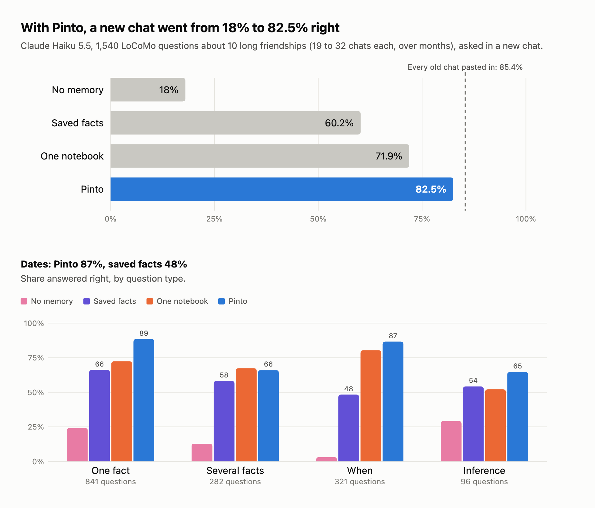

# Does your AI remember better with notes?

Every new chat with ChatGPT or Claude starts blank. We tested how much an AI remembers about months of past chats when it has nothing, a short list of saved facts, one notebook, or [Pinto Notes](https://pintonotes.com) connected. Everything here reruns on your own machine.

**Short answer.** In a new chat, Claude Haiku answered 18% of 1,540 questions about past chats right. With Pinto connected it answered 82.5%. On "when did…" questions it went from 3% to 87%, against 48% for a list of saved facts.



(`results/chart.html` is the interactive version.)

## The test

[LoCoMo](https://github.com/snap-research/locomo) (Maharana et al., ACL 2024) is the benchmark AI-memory products quote. It has 10 long conversations between two friends, each 19 to 32 chats spread over months, and 1,540 questions about them (we leave out the adversarial category, as every published score does).

We treat each chat as a separate chat with the AI. After the last one, the questions come in a **new chat**. What the new chat has:

| Condition | What the new chat sees |
|---|---|
| No memory | Nothing. |
| Saved facts | Up to 5 one-line facts the AI chose to save after each chat. Our stand-in for a memory list. It is **not** ChatGPT's or Claude's built-in memory. |
| One notebook | A single markdown notebook the AI rewrote after each chat, asked to stay under 2,000 words. |
| Pinto | Pinto Notes connected through its real MCP server code (12 file tools and its instructions, [commit 80ce88ca](https://github.com/pinto-notes/pinto-notes/tree/80ce88ca/supabase/functions/mcp)) running on a local in-memory database. After each chat the AI was told: "Remember this chat in Pinto Notes for next time." In the new chat it looked things up with search, list and fetch. |
| Every old chat pasted in | All transcripts in the prompt. No chat app lets you do this, and it stops working once a history is long, so we treat it as the ceiling, not an option. |

## Results

**Claude Haiku 5.5** (`claude-haiku-5-5`), LoCoMo, share answered right:

| | All | One fact | Several facts | When | Inference |
|---|---|---|---|---|---|
| No memory | 18.0% | 24.1% | 12.8% | 3.1% | 29.2% |
| Saved facts | 60.2% | 66.1% | 58.2% | 48.3% | 54.2% |
| One notebook | 71.9% | 72.4% | 67.4% | 80.4% | 52.1% |
| **Pinto** | **82.5%** | **88.5%** | 66.0% | **86.6%** | **64.6%** |
| Every old chat pasted in (ceiling) | 85.4% | 93.6% | 72.0% | 83.5% | 59.4% |

A second full run of the first four rows (new notebooks, new answers) landed within 2.5 points: 16.2%, 59.4%, 69.5%, 86.8%.

**GPT-6 Luna** (`gpt-6-luna`, low reasoning), same test: no memory 18.3%, saved facts 43.6%, one notebook 74.5%, every chat pasted in 80.5%. On dates the notebook beat pasting everything: 80.1% against 73.5%. GPT's saved facts did badly on dates (11.5%): one-liners drop the date.

**What Pinto did:** across the 10 conversations Haiku created 275 notes, made 937 edits and ran 600 searches and 6,671 fetches. It kept a note per person and per chat. With no limit it kept a lot: 8,000 to 24,000 words per pair of friends, often more than the chats themselves. Per question it read about 10,000 tokens, close to the one-notebook condition.

## What this does not show

- **It is not a comparison with ChatGPT's or Claude's built-in memory.** "Saved facts" is a simulation. We can't say Pinto beats them.
- **Pasting everything still wins when it fits.** On LongMemEval-S (48 questions, 8 per type, each with its own ~50-chat, ~165k-token history), Haiku scored 91.7% with every chat pasted in, 70.8% with one notebook (reading ~10k tokens instead of ~168k) and 2.1% with nothing. Today's models read long input well. A year of real chats is still far more than fits in a prompt.
- **One benchmark of two friends talking,** not a person talking with their own assistant. LongMemEval is that format; we ran the notebook there, not Pinto.
- **Small models only.** See the next section.

## Bigger models have memorized LoCoMo

We also ran Claude Sonnet 5.5. With no memory at all it answered 45.7% right, and 27.7% of the date questions, often word for word ("7 May 2023", "the week before 3 July 2023"). A blank chat can't know those dates. LoCoMo has been public since 2024 and Sonnet has learned it. Haiku (3.1% on dates with no memory) and GPT-6 Luna (6.5%) show no sign of this. The order of the conditions is the same on Sonnet (46 / 72 / 78 / 87 / 90), but its numbers are inflated, so the headline uses Haiku. Be careful with any LoCoMo score from a large model, including very high ones.

## Grading

A Claude Sonnet 5.5 grader marked each answer correct or wrong against the gold answer (the lenient prompt used in Mem0's LoCoMo runs). To check it, Claude Opus graded 100 random answers, 25 per condition, blind to the grader, under a stricter rule. They agreed on 99. In the one disagreement the grader was stricter. That is still one model checking another; `grading/opus_vs_model_100.json` lists the 100 so a person can check them.

## Run it yourself

You need Python 3.11+, [Deno](https://deno.com) 2.x for the Pinto condition, and the [Claude Code](https://claude.com/claude-code) CLI signed in. The GPT runs use the [Codex CLI](https://github.com/openai/codex). Every model call goes through those CLIs with no tools, no MCP servers other than the local Pinto one, and no project files in context.

```sh
scripts/fetch_data.sh                    # LoCoMo, LongMemEval-S, Pinto at 80ce88ca
python3 scripts/run.py --convs 0 --limit 20 --tag try   # a quick pilot: one conversation, 20 questions

# The full Haiku run (none, facts, notebook, full):
python3 scripts/run.py --convs all --model haiku --tag haiku

# Pinto: start the local server, then run the pinto condition
scripts/start_pinto_server.sh 8791 &
PINTO_MCP=http://127.0.0.1:8791 python3 scripts/run.py --convs all --conds pinto --tag haiku-pinto --workers 10

# GPT: a Codex home that holds only your auth.json
mkdir -p /tmp/codex-home && cp ~/.codex/auth.json /tmp/codex-home/
MEMSTUDY_CODEX_HOME=/tmp/codex-home python3 scripts/run.py --convs all --model codex:gpt-6-luna --tag gpt

# Long history
python3 scripts/longmem.py --per-type 8 --model haiku --tag lme-haiku

# Every number in this README, from results/
python3 scripts/summarize.py --readable  # --readable also writes question / gold / answer CSVs
```

Your runs go to `runs/`. Our runs are in `results/`.

**Cost.** We ran everything on Claude and ChatGPT subscriptions through their CLIs: about 1,300 calls per Haiku run and more for Pinto (it looks things up). On the API it would cost money; the pilot above is small.

## Files

| Path | What |
|---|---|
| `scripts/run.py` | The LoCoMo test: memory building, answering, grading. |
| `scripts/longmem.py` | The LongMemEval-S test. |
| `scripts/pinto_mcp_local.ts` | Pinto's MCP file tools served over HTTP from a local in-memory Postgres (PGlite), one empty account per conversation. |
| `scripts/summarize.py` | All the tables above, from `results/`. |
| `results/locomo/<run>/` | Every answer and grade, by conversation and question number, plus memory size after each chat. |
| `results/locomo/pinto_tool_calls.json` | How many times the AI called each Pinto tool. |
| `results/longmemeval/haiku/` | LongMemEval answers and grades. |
| `grading/opus_vs_model_100.json` | The grader check. |

## Licences

Code: MIT. Results: CC BY 4.0.

We don't redistribute the benchmarks. LoCoMo is CC BY-NC 4.0, so `results/` holds our answers keyed by question number, not LoCoMo's text, and not the notes the AI wrote from it (those are rewrites of LoCoMo's conversations). `fetch_data.sh` downloads LoCoMo and LongMemEval (MIT) from their sources, and `summarize.py --readable` joins them with our answers on your machine.

## Credits

LoCoMo: Maharana, Lee, Tulyakov, Bansal, Barbieri, Fang. *Evaluating Very Long-Term Conversational Memory of LLM Agents*, ACL 2024. LongMemEval: Wu, Wang, Yu, Zhang, Chang, Yu. *LongMemEval: Benchmarking Chat Assistants on Long-Term Interactive Memory*, 2024. The grading prompt follows Mem0's LoCoMo evaluation (Chhikara et al., 2025).

Made by [Pinto Notes](https://pintonotes.com).
